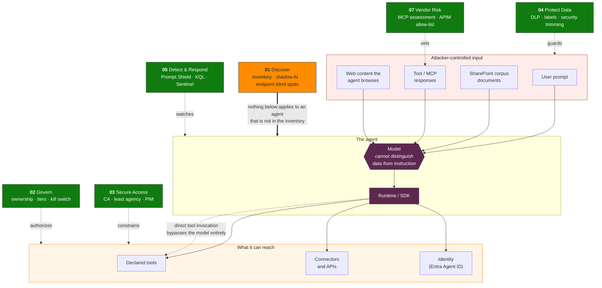

# The agent attack surface

Moved out of the [main README](../README.md#the-agent-attack-surface) to keep its entry short.

Agents introduce four surfaces that traditional security tooling does not cover. Every domain in this framework maps to closing one of them.

**Domain 01 is the precondition, not a peer.** It sits above the others in orange because it does not guard a surface — it establishes that the agent exists at all. An agent absent from the inventory has no Conditional Access policy applied, no owner to escalate to, and no Sentinel rule watching it. Every green control below is silently inapplicable to it.

**Domain 06 (Regulatory) is not on this diagram** because it does not defend a surface either. It is the evidence layer: proving to an auditor or supervisor that the controls above were designed, deployed, and tested. It consumes the output of all seven domains rather than guarding any one of them.

**The dotted line matters most.** Every prompt-layer control assumes the model sits in the execution path. Research presented at BlackHat USA 2026 documented agent runtimes across three major SDKs that execute a supplied tool-call block **with no model invocation in between** — which means Prompt Shield, content filters, and every prompt-scoring KQL query never fire, because they were never in the path. See [Track B Module-02 point 11](../Track-B-Architect/Module-02-Govern.md).

**A convergent naming worth adopting when you brief this to others:** Microsoft's own Agent 365 governance materials describe this same surface with a six-flow shorthand — H2A (human-to-agent prompt), A2H (agent-to-human response), A2A (agent-to-agent invocation), A2LLM (agent-to-model inference), A2App (agent-to-application action), and agent-to-data-source read/write. It maps directly onto the diagram above: H2A/A2H is the user prompt edge, A2A is the direct-tool-invocation and agent-to-agent injection surface (Module 02 points 9 and 11), A2LLM is the model edge itself, and A2App plus the data-source edges are the blast radius on the right. Independent convergence on the same six control points, from a product governance angle rather than a security-research angle, is a reasonable signal that this is the right way to decompose the surface — use whichever vocabulary lands better with the audience in the room.
